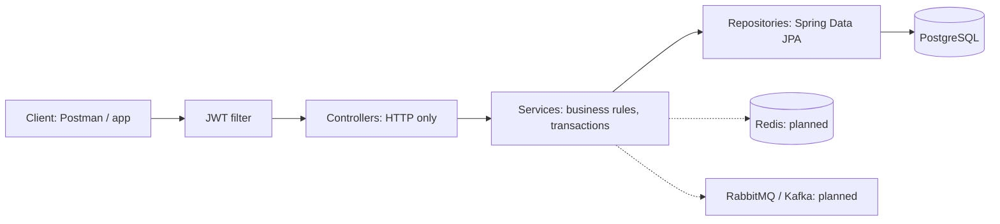
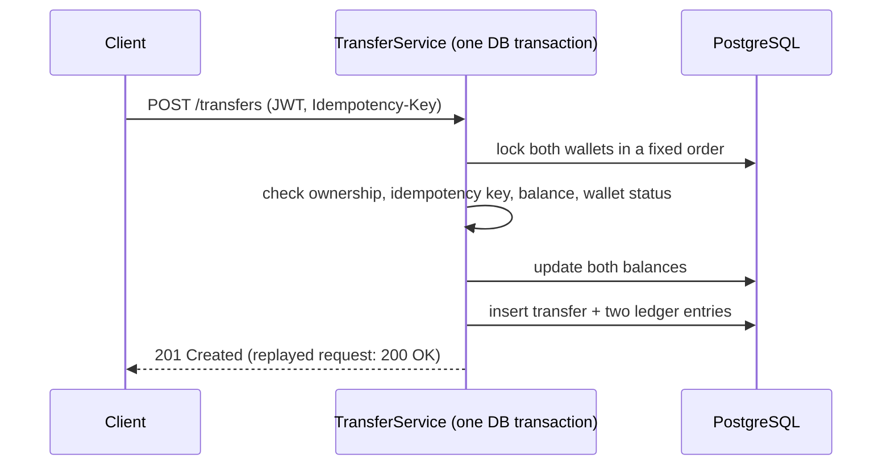
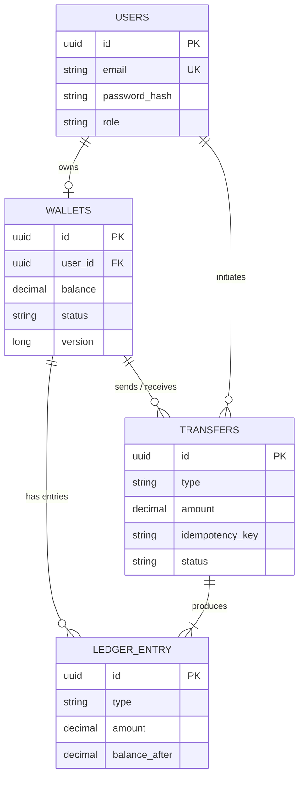

# SafePay

A digital wallet and payments REST API built with **Spring Boot**, designed around the things that go wrong in real payment systems: **double debits on retries, race conditions on balances, and unexplained money movement.**


> **Project status:** actively developed as a learning project. See the [Roadmap](#roadmap) for what is finished and what is in progress.

---

## Table of contents
- [Features](#features)
- [Tech stack](#tech-stack)
- [Architecture](#architecture)
- [Data model](#data-model)
- [API overview](#api-overview)
- [Getting started](#getting-started)
- [Quick tour with curl](#quick-tour-with-curl)
- [Design decisions](#design-decisions)
- [Security notes](#security-notes)
- [Project structure](#project-structure)
- [Testing](#testing)
- [Roadmap](#roadmap)

---

## Features

**Accounts and security**
- User registration and login with **JWT access tokens**
- Passwords hashed with **BCrypt**
- Role-based access control (`USER`, `ADMIN`)
- Stateless sessions; the user is **loaded from the database on every request**, so a disabled account or changed role takes effect immediately
- JSON `401` / `403` responses from the security layer

**Wallets and money movement**
- One wallet per user
- Deposits and wallet-to-wallet transfers
- **Append-only double-entry ledger**: every balance change is recorded as an immutable entry
- Money stored as `BigDecimal` / `NUMERIC`, never floating point
- Database check constraints (non-negative balance, positive amounts)
- Paginated transaction history

**API quality**
- Layered design: controller, service, repository
- Bean Validation on all request DTOs
- Entities never exposed; DTOs only
- Centralised exception handling with a consistent JSON error format

**In progress** (see [Roadmap](#roadmap)): idempotent transfers, concurrency hardening, refresh tokens, Redis rate limiting, RabbitMQ notifications, Kafka fraud detection.

---

## Tech stack

| Area | Technology |
|---|---|
| Language | Java 21 |
| Framework | Spring Boot (Spring MVC, Spring Data JPA, Bean Validation) |
| Security | Spring Security, JWT (jjwt), BCrypt |
| Database | PostgreSQL, Hibernate |
| Build | Maven (wrapper included) |
| Planned | Redis, RabbitMQ, Apache Kafka, Docker Compose |

---

## Architecture



Each layer talks only to the one below it:
- **Controllers** parse and validate requests and choose HTTP status codes. No business logic.
- **Services** hold the rules (balance checks, ownership, transactions).
- **Repositories** only read and write data.

### What happens during a transfer


Everything in the transaction commits together or rolls back together.

---

## Data model



**Invariant:** for every wallet, `balance = sum(CREDIT entries) - sum(DEBIT entries)`. The ledger is the source of truth; the `balance` column is a fast copy that can be reconciled against it.

---

## API overview

Base path: `/api/v1`. Endpoints marked 🔒 need `Authorization: Bearer <access token>`.

### Authentication
| Method | Path | Description | Success |
|---|---|---|---|
| POST | `/auth/register` | Create an account | 201 |
| POST | `/auth/login` | Get an access token | 200 |
| GET 🔒 | `/users/me` | Current user profile | 200 |

### Wallets
| Method | Path | Description | Success |
|---|---|---|---|
| POST 🔒 | `/wallets` | Create your wallet | 201 |
| GET 🔒 | `/wallets/me` | View your wallet and balance | 200 |
| GET 🔒 | `/wallets/me/ledger?page=0&size=20` | Paginated ledger entries | 200 |
| POST 🔒 | `/wallets/me/deposit` | Add funds (simulated top-up) | 201 |

### Transfers
| Method | Path | Description | Success |
|---|---|---|---|
| POST 🔒 | `/transfers` | Send money to another wallet. Header `Idempotency-Key` required | 201 (replay: 200) |

> Endpoint paths above describe the target API; check the controllers for the exact current routes while the API is being finalised.

### Error format
Every error has the same shape:
```json
{
  "timestamp": "2026-10-15T10:21:33Z",
  "status": 422,
  "error": "Unprocessable Entity",
  "code": "INSUFFICIENT_BALANCE",
  "message": "Balance is lower than the requested amount",
  "path": "/api/v1/transfers"
}
```

| Status | Used for |
|---|---|
| 400 | validation errors, malformed JSON, missing header |
| 401 | missing or invalid token, wrong credentials |
| 403 | authenticated but not allowed |
| 404 | resource not found (or not yours) |
| 409 | duplicate email, idempotency key reused with a different request |
| 422 | well-formed request that breaks a business rule (insufficient balance, frozen wallet) |

---

## Getting started

### Prerequisites
- JDK 21
- A PostgreSQL database (local, Docker, or a hosted instance such as Render)
- Git

No separate Maven install is needed; the project includes the Maven wrapper.

### 1. Clone
```bash
git clone https://github.com/LordsOwnAcc/safepay.git
cd safepay
```

### 2. Configure environment variables
Secrets are **never** stored in the repository. Set these variables before running:

| Variable | Description | Example |
|---|---|---|
| `DB_URL` | JDBC URL of your PostgreSQL database | `jdbc:postgresql://localhost:5432/safepay` (hosted databases usually need `?sslmode=require`) |
| `DB_USER` | Database username | |
| `DB_PASS` | Database password | |
| `JWT_SECRET` | Base64 secret of at least 32 random bytes | see below |

Generate a JWT secret:
```bash
# macOS / Linux / Git Bash
openssl rand -base64 32
```
```powershell
# Windows PowerShell
$b = New-Object byte[] 32
[Security.Cryptography.RandomNumberGenerator]::Create().GetBytes($b)
[Convert]::ToBase64String($b)
```

Set them for your shell session, for example (bash):
```bash
export DB_URL="jdbc:postgresql://localhost:5432/safepay"
export DB_USER="postgres"
export DB_PASS="your-password"
export JWT_SECRET="your-generated-secret"
```
In IntelliJ: *Run → Edit Configurations → Environment variables*.

### 3. Run
```bash
./mvnw spring-boot:run          # Windows: mvnw.cmd spring-boot:run
```
The API starts on `http://localhost:8080`. Hibernate creates the tables on first start (`ddl-auto=update`, suitable for development).

### 4. Create an admin (optional)
Register a normal user, then promote it in the database:
```sql
UPDATE users SET role = 'ADMIN' WHERE email = 'you@example.com';
```
Log in again to get a token with the new role.

---

## Quick tour with curl

```bash
# 1. Register
curl -X POST localhost:8080/api/v1/auth/register \
  -H "Content-Type: application/json" \
  -d '{"fullName":"Asha","email":"asha@example.com","password":"Passw0rdA"}'

# 2. Log in (copy accessToken from the response)
curl -X POST localhost:8080/api/v1/auth/login \
  -H "Content-Type: application/json" \
  -d '{"email":"asha@example.com","password":"Passw0rdA"}'

TOKEN="<paste accessToken here>"

# 3. Create a wallet and deposit funds
curl -X POST localhost:8080/api/v1/wallets -H "Authorization: Bearer $TOKEN"
curl -X POST localhost:8080/api/v1/wallets/me/deposit \
  -H "Authorization: Bearer $TOKEN" -H "Content-Type: application/json" \
  -H "Idempotency-Key: $(uuidgen)" -d '{"amount": 1000.00}'

# 4. Transfer to another wallet
curl -X POST localhost:8080/api/v1/transfers \
  -H "Authorization: Bearer $TOKEN" -H "Content-Type: application/json" \
  -H "Idempotency-Key: $(uuidgen)" \
  -d '{"toWalletId":"<receiver wallet id>","amount": 250.00}'

# 5. View your ledger
curl "localhost:8080/api/v1/wallets/me/ledger?page=0&size=10" -H "Authorization: Bearer $TOKEN"
```

---

## Design decisions

**Why a ledger, not just a balance column?**
Every change is an immutable entry, so any balance can be explained and audited. Mistakes are corrected with a new opposite entry, never by editing history. The wallet balance is a convenience copy that can be reconciled against the ledger.

**Why `BigDecimal`?**
`0.1 + 0.2` is `0.30000000000000004` in floating point. Money uses `BigDecimal` in Java and `NUMERIC` in PostgreSQL, compared with `compareTo`.

**How are race conditions prevented?**
Two simultaneous transfers could both read the same balance and overspend it. SafePay locks the affected wallet rows (`SELECT ... FOR UPDATE`) inside the transaction, always in the same order to avoid deadlocks, and keeps an optimistic `@Version` field as a safety net.

**How are retries made safe?**
Clients send an `Idempotency-Key` header. The key is stored with the transfer under a unique database constraint, scoped per user. A repeated request returns the original result instead of moving money again; the same key with a different request is rejected with `409`.

**Why load the user from the database on every request?**
The JWT proves identity; the database provides current state. A disabled account or demoted role is blocked immediately instead of when the token expires. The cost is one primary-key lookup per request, which can be cached briefly later.

**Why `@Transactional` services and DTOs only?**
A transfer changes two wallets, one transfer row and two ledger rows. They must succeed or fail together. DTOs keep entities, password hashes and internal fields out of API responses.

---

## Security notes

- Passwords are hashed with BCrypt; hashes are never returned.
- The user's role is assigned by the server only; clients cannot choose it.
- A wrong email and a wrong password produce the same error message.
- Users can read and spend only from their **own** wallet; requests for someone else's wallet look like "not found".
- The JWT secret and database credentials come from environment variables. Never commit them.
- Use HTTPS in any deployed environment.

---

## Project structure

```
src/main/java/com/safepay/safepay
├── config/        security and password configuration
├── controller/    REST controllers
├── dto/           request and response objects
├── exception/     custom exceptions and global handler
├── model/         JPA entities and enums
├── repository/    Spring Data repositories
├── security/      JWT service, JWT filter, UserDetails, 401/403 handlers
└── service/       business logic
```

---

## Testing

```bash
./mvnw test
```

Planned test coverage: JWT creation and validation (tampered, expired, wrong key), wallet debit and credit rules, and a concurrency test that fires parallel transfers at one wallet and asserts the balance never goes negative.

---

## Roadmap

- [x] Registration, login, JWT authentication, role-based authorization
- [x] Wallet, deposit, transfer and ledger endpoints
- [ ] Money-movement hardening: strict debit rules, ordered locking, validation on all money endpoints
- [ ] Idempotency-Key support for deposits and transfers
- [ ] Consistent error format for every error (including security-layer errors)
- [ ] Concurrency and invariant tests
- [ ] Refresh tokens with rotation and reuse detection
- [ ] Redis: rate limiting, token revocation, idempotency fast path (Docker Compose)
- [ ] RabbitMQ: notifications with retry and dead-letter queue
- [ ] Kafka: transaction events and a fraud-detection consumer
- [ ] Split fraud and notification services into separate microservices

---

## Author

Built by [@LordsOwnAcc](https://github.com/LordsOwnAcc) as a hands-on project to learn production-grade Spring Boot: security, transactions, concurrency, caching and messaging.
